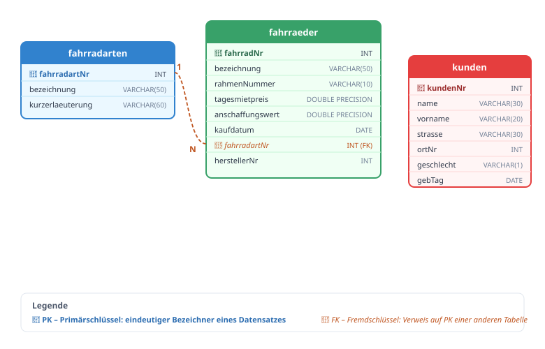
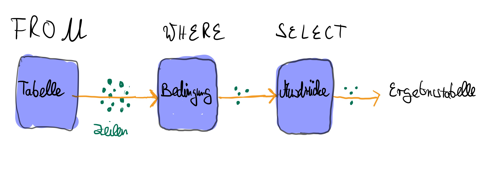

# Auswahl von Zeilen und Spalten

SQL ist eine Abfragesprache für Datenbanken. Dafür steht der volle Name
*Structured Query Language*.

Für die Abfragen brauchst du eine Datenbank.
Deshalb baut jedes Kapitel die Datenbank zu Beginn neu auf.

```sql
CREATE TABLE fahrradarten (
    fahrradartNr     int NOT NULL,
    bezeichnung      varchar(50),
    PRIMARY KEY (fahrradartNr)
);
```

<codapi-snippet engine="pglite" sandbox="postgres" editor="none" output-mode="table">
</codapi-snippet>

```sql
INSERT INTO fahrradarten VALUES
(1, 'Mountain-Bike'),
(2, 'Cross-Bike'),
(3, 'BMX-Bike'),
(4, 'DirtBike'),
(5, 'Einrad'),
(6, 'Tandem'),
(7, 'Kinderfahrrad ab 20 Zoll'),
(8, 'Jugendfahrrad'),
(9, 'Kinderrad Fahrrad 12-18 Zoll'),
(10, 'Jugendfahrrad ab 26 Zoll'),
(11, 'Rennrad'),
(12, 'Damen City-Bike'),
(13, 'Herren City-Bike'),
(14, 'Kinderanhänger');
```

<codapi-snippet engine="pglite" sandbox="postgres" editor="none" output-mode="table">
</codapi-snippet>

```sql
CREATE TABLE fahrraeder (
    fahrradNr        int NOT NULL,
    bezeichnung      varchar(50),
    tagesmietpreis   double precision,
    fahrradartNr     int,
    PRIMARY KEY (fahrradNr),
    FOREIGN KEY (fahrradartNr) REFERENCES fahrradarten (fahrradartNr)
);
```

<codapi-snippet engine="pglite" sandbox="postgres" editor="none" output-mode="table">
</codapi-snippet>

```sql
INSERT INTO fahrraeder VALUES
(1, 'Comus Einrad', 8.40, 5),
(2, 'Panther Thedy', 9.45, 9),
(3, 'Scott Comtessa', 10.50, 9),
(4, 'Scott Voltage Jr 16', 12.60, 9),
(5, 'Yazoo FSV-3.6N', 17.85, 10),
(6, 'Scott Aspect 50', 19.95, 1),
(7, 'Yazoo FSV-3.6N', 17.85, 10),
(8, 'Comus Einrad XM', 8.40, 5);
```

<codapi-snippet engine="pglite" sandbox="postgres" editor="none" output-mode="table">
</codapi-snippet>

```sql
CREATE TABLE kunden (
    kundenNr   int NOT NULL,
    name       varchar(30),
    vorname    varchar(20),
    geschlecht varchar(1),
    PRIMARY KEY (kundenNr)
);
```

<codapi-snippet engine="pglite" sandbox="postgres" editor="none" output-mode="table">
</codapi-snippet>

```sql
INSERT INTO kunden VALUES
(232, 'Schneider', 'Heinrich', 'm'),
(233, 'Schlauch', 'Franz', 'm'),
(234, 'Schlauch', 'Franziska', 'w'),
(235, 'Böckle', 'Jennifer', 'w'),
(236, 'Hauffe', 'Johann', 'm'),
(237, 'Yilmaz', 'Ali', 'm'),
(238, 'Berger', 'Johann', 'm');
```
<codapi-snippet engine="pglite" sandbox="postgres" editor="none" output-mode="table">
</codapi-snippet>


Um schnell zu sehen, wie eine Datenbank aufgebaut ist, nutzt du
Diagramme. Darin stehen alle Tabellen mit Spalten, aber ohne Datensätze. Jedes Rechteck ist eine
Tabelle: oben der Tabellenname, darunter die Spalten mit Datentypen. Linien zeigen die Beziehungen
zwischen Tabellen. Das Diagramm zeigt die Datenbank aus diesem Kapitel.




## Ganze Tabellen anzeigen

Um eine ganze Tabelle zu zeigen, schreibst du hinter `SELECT` ein
`*` und in die nächste Zeile `FROM` plus Tabellenname. Die Tabelle von oben bekommst du so:

```sql
SELECT *
FROM kunden;
```
<codapi-snippet engine="pglite" sandbox="postgres" editor="none" output-mode="table">
</codapi-snippet>

## Auswahl von Spalten

Mit `SELECT`-Befehlen können wir auch nur ausgewählte Spalten
einer Tabelle anschauen. Hierfür schreibt man hinter `SELECT` die
Namen der gewünschten Spalten. Zwischen zwei Spaltennamen muss ein Komma
stehen. Anschließend folgt das Schlüsselwort `FROM` und der Name
der Tabelle, aus der die Spalten stammen.

```sql
SELECT vorname, name
FROM kunden;
```
<codapi-snippet engine="pglite" sandbox="postgres" editor="none" output-mode="table">
</codapi-snippet>


## Berechnete Spalten

Du kennst `SELECT` schon zum Rechnen. Das geht auch mit Spaltenwerten.
Du willst zum Beispiel sehen, welche Räder unter 10 € kosten:

```sql
SELECT fahrradNr, bezeichnung, tagesmietpreis < 10
FROM fahrraeder;
```
<codapi-snippet engine="pglite" sandbox="postgres" editor="none" output-mode="table">
</codapi-snippet>


Für jede Zeile in *fahrraeder* rechnet SQL den Ausdruck aus `tagesmietpreis` aus und zeigt ihn als neue Spalte.

Damit im Spaltenkopf nicht der ganze Ausdruck steht, benennst du die Spalte mit `AS` um.

```sql
SELECT fahrradNr, bezeichnung, tagesmietpreis < 10 AS
tagesmietpreis_unter_10_euro FROM fahrraeder;
```
<codapi-snippet engine="pglite" sandbox="postgres" editor="none" output-mode="table">
</codapi-snippet>


## Auswahl von Zeilen

Wenn du nur Fahrräder mit einem Tagesmietpreis unter 10 € sehen willst,
filterst du die Tabelle über diese Bedingung.


Dafür ergänzt du die `SELECT`-Anweisung um eine `WHERE`-Klausel.
Hinter `WHERE` steht die Bedingung.
Nur Zeilen, die diese Bedingung erfüllen, erscheinen im Ergebnis.

```sql
SELECT fahrradNr, bezeichnung
FROM fahrraeder
WHERE tagesmietpreis < 10;
```
<codapi-snippet engine="pglite" sandbox="postgres" editor="none" output-mode="table">
</codapi-snippet>


## Veranschaulichung

In den bisherigen Abfragen steht hinter `FROM` genau eine Tabelle.
Mit `WHERE` filterst du die Zeilen.
Nur passende Zeilen bleiben übrig.
Hinter `SELECT` stehen Spaltennamen oder Ausdrücke.
SQL berechnet sie für jede übrige Zeile.
Das Ergebnis ist die Ergebnistabelle.



