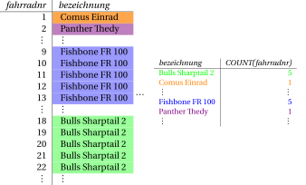
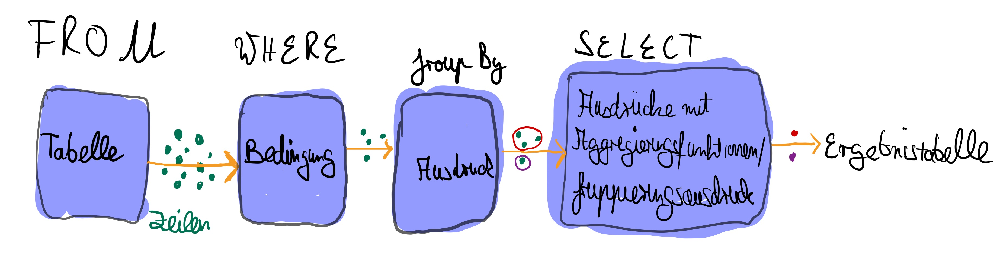
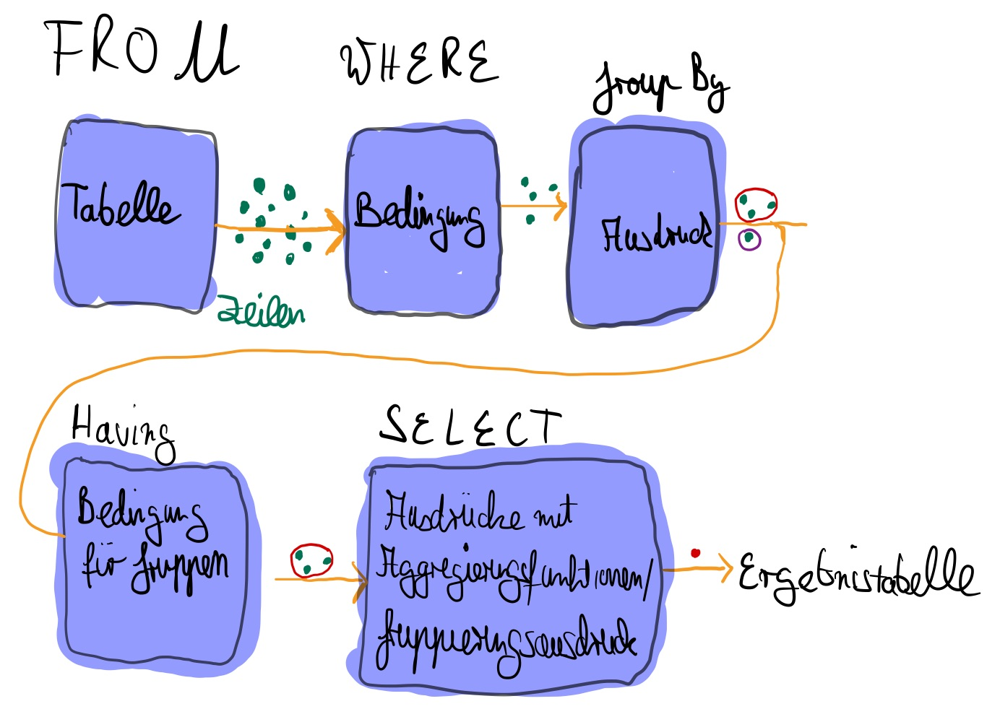

# Gruppierungen


```sql
CREATE TABLE fahrraeder (
    fahrradNr        int NOT NULL,
    bezeichnung      varchar(50),
    tagesmietpreis   double precision,
    fahrradartNr     int,
    PRIMARY KEY (fahrradNr)
);
```

<codapi-snippet engine="pglite" sandbox="postgres" editor="none" output-mode="table">
</codapi-snippet>

```sql
INSERT INTO fahrraeder VALUES
(1, 'Comus Einrad', 8.40, 5),
(2, 'Panther Thedy', 9.45, 9),
(3, 'Scott Comtessa', 10.50, 9),
(4, 'Scott Voltage Jr 16', 12.60, 9),
(5, 'Yazoo FSV-3.6N', 17.85, 10),
(6, 'Scott Aspect 50', 19.95, 1),
(7, 'Yazoo FSV-3.6N', 17.85, 10),
(8, 'Comus Einrad XM', 8.40, 5),
(9, 'Fishbone FR 100', 19.95000, 3),
(10, 'Fishbone FR 100', 19.95000, 3),
(11, 'Fishbone FR 100', 19.95000, 3),
(12, 'Fishbone FR 100', 19.95000, 3),
(13, 'Fishbone FR 100', 19.95000, 3),
(14, 'Scott Comtessa', 10.50000, 9),
(15, 'Yazoo FSV-3.6N', 17.85000, 10),
(16, 'Scott Aspect 50', 19.95000, 1),
(17, 'Scott Aspect 50', 19.95000, 1),
(18, 'Bulls Sharptail 2', 21.00000, 1),
(19, 'Bulls Sharptail 2', 21.00000, 1),
(20, 'Bulls Sharptail 2', 21.00000, 1),
(21, 'Bulls Sharptail 2', 21.00000, 1),
(22, 'Bulls Sharptail 2', 21.00000, 1);
```
<codapi-snippet engine="pglite" sandbox="postgres" editor="none" output-mode="table">
</codapi-snippet>

## Gruppierungen


Mit `GROUP BY` teilst du Zeilen nach dem Wert einer Spalte oder eines Ausdrucks in Gruppen ein.
Für jede Gruppe berechnest du dann mit einer Aggregierungsfunktion einen Wert.
Beispiel: Du gruppierst alle Zeilen von *fahrraeder* nach *bezeichnung* und zählst pro Gruppe die Fahrräder.




Dafür schreibst du hinter `GROUP BY` den Ausdruck, nach dem du gruppierst:

```sql
SELECT bezeichnung, COUNT(fahrradNr)
FROM fahrraeder
GROUP BY bezeichnung;
```
<codapi-snippet engine="pglite" sandbox="postgres" editor="none" output-mode="table">
</codapi-snippet>

Du bekommst so viele Gruppen, wie es verschiedene Werte gibt. Hier: eine Gruppe pro *bezeichnung* in *fahrraeder*.

Wenn du `GROUP BY` nutzt, darf hinter `SELECT` nur der Gruppierungsausdruck und Ausdrücke mit Aggregierungsfunktionen stehen.
Bei allen anderen Spalten ist pro Gruppe kein eindeutiger Wert definiert.





## Filtern von Gruppen

Mit `WHERE` formulierst du eine Bedingung für Zeilen.
SQL betrachtet dann nur Zeilen, die diese Bedingung erfüllen.

`WHERE` filtert Zeilen vor der Gruppierung.
`GROUP BY` gruppiert die übrigen Zeilen.
Diese Gruppen filterst du mit `HAVING`.
Hinter `HAVING` steht die Bedingung an die Gruppen.

In dieser Bedingung sind nur Aggregatausdrücke oder der Gruppierungsausdruck erlaubt.
Für andere Ausdrücke ist pro Gruppe kein eindeutiger Wert definiert.

```sql
SELECT COUNT(fahrradNr), bezeichnung
FROM fahrraeder
GROUP BY bezeichnung
HAVING COUNT(fahrradNr) > 4;
```
<codapi-snippet engine="pglite" sandbox="postgres" editor="none" output-mode="table">
</codapi-snippet>


So läuft `SELECT` mit `GROUP BY` und `HAVING` ab:




